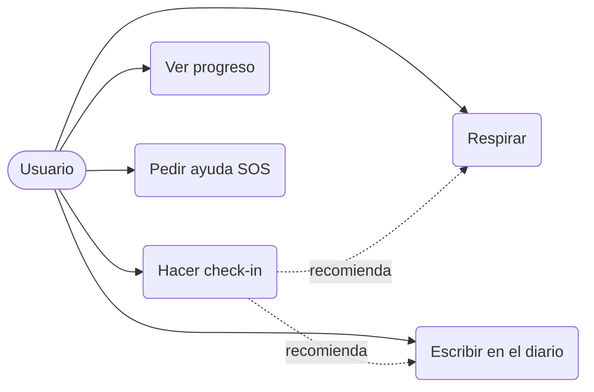

# Análisis de requisitos

## Contexto y usuarios

Aura se dirige a **adultos de 18 a 45 años** con estrés o ansiedad leves y cotidianos, que quieren herramientas de autocuidado sin esperar a una consulta. No pretende tratar trastornos: **deriva a ayuda profesional** cuando detecta señales de riesgo.

### Personas

| Persona | Necesidad | Reto |
| --- | --- | --- |
| **Lucía**, 27, desarrolladora | Calmarse antes de reuniones | Poco tiempo, olvida hábitos |
| **Marcos**, 34, repartidor | Dormir mejor | Móvil con poca memoria |
| **Ana**, 41, madre y docente | Entender qué le afecta | Desconfía de su privacidad |

## Requisitos funcionales

| ID | Requisito | Prioridad |
| --- | --- | --- |
| RF-01 | El usuario puede registrar su estado de ánimo (escala 1-5) y asociar factores | Alta |
| RF-02 | El sistema recomienda un ejercicio según el estado registrado | Alta |
| RF-03 | El usuario puede realizar ejercicios de respiración guiada con temporizador | Alta |
| RF-04 | El usuario puede escribir entradas de diario y el sistema sugiere reformulaciones ante patrones de pensamiento negativos | Media |
| RF-05 | El usuario puede consultar la evolución de su ánimo (media, gráfica semanal) | Media |
| RF-06 | Existe un acceso SOS visible desde cualquier pantalla con teléfonos de ayuda | **Crítica** |
| RF-07 | El usuario puede exportar o borrar todos sus datos | Alta |
| RF-08 | Recordatorios diarios configurables | Baja |

## Requisitos no funcionales

| ID | Categoría | Requisito |
| --- | --- | --- |
| RNF-01 | Privacidad | Datos cifrados en el dispositivo; cumplimiento del **RGPD** (datos de salud = categoría especial) |
| RNF-02 | Disponibilidad | Todas las funciones esenciales (incluido SOS) funcionan **sin conexión** |
| RNF-03 | Rendimiento | Pantalla de inicio en menos de 2 s en un móvil de gama media |
| RNF-04 | Accesibilidad | Cumplir WCAG 2.2 AA: contraste, tamaño de texto, lector de pantalla |
| RNF-05 | Usabilidad | Un check-in se completa en menos de 15 s |
| RNF-06 | Seguridad | Sin analítica de terceros que reciba contenido del diario |

## Casos de uso principales

## Riesgos identificados

- **Uso como sustituto de terapia.** Mitigación: avisos claros y derivación a profesionales.
- **Filtración de datos sensibles.** Mitigación: almacenamiento local cifrado y mínimo de datos en servidor.
- **Falsa sensación de seguridad ante una crisis.** Mitigación: SOS siempre accesible y sin conexión.
