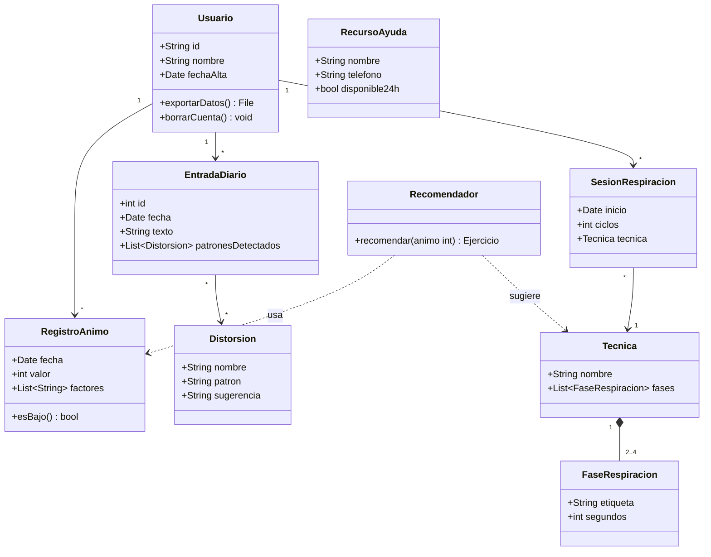
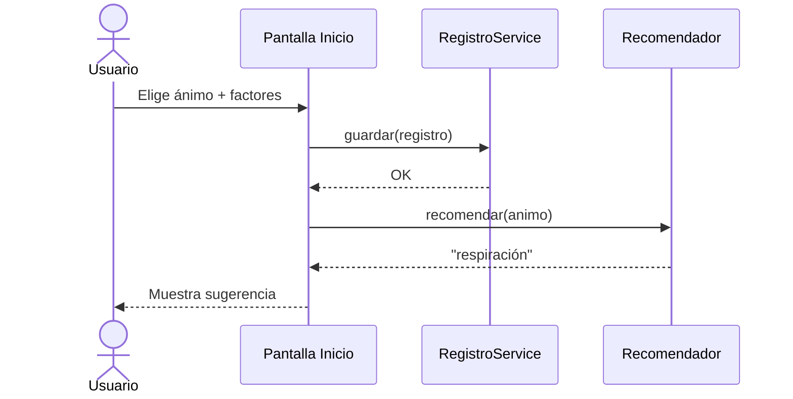

# Diseño: diagrama de clases

## Modelo de dominio

## Flujo del check-in

## Decisiones de diseño

| Decisión | Motivo |
| --- | --- |
| `Recomendador` aislado del resto | Función pura: fácil de probar (ver [pruebas](../pruebas/analisis_caja_blanca.md)) |
| `Tecnica` definida por datos (fases) | Añadir una técnica nueva no requiere código nuevo |
| `RecursoAyuda` embebido en la app | El SOS funciona sin conexión |
| Detector de patrones con reglas simples | Transparente y explicable, sin enviar texto del diario a ningún servidor |
