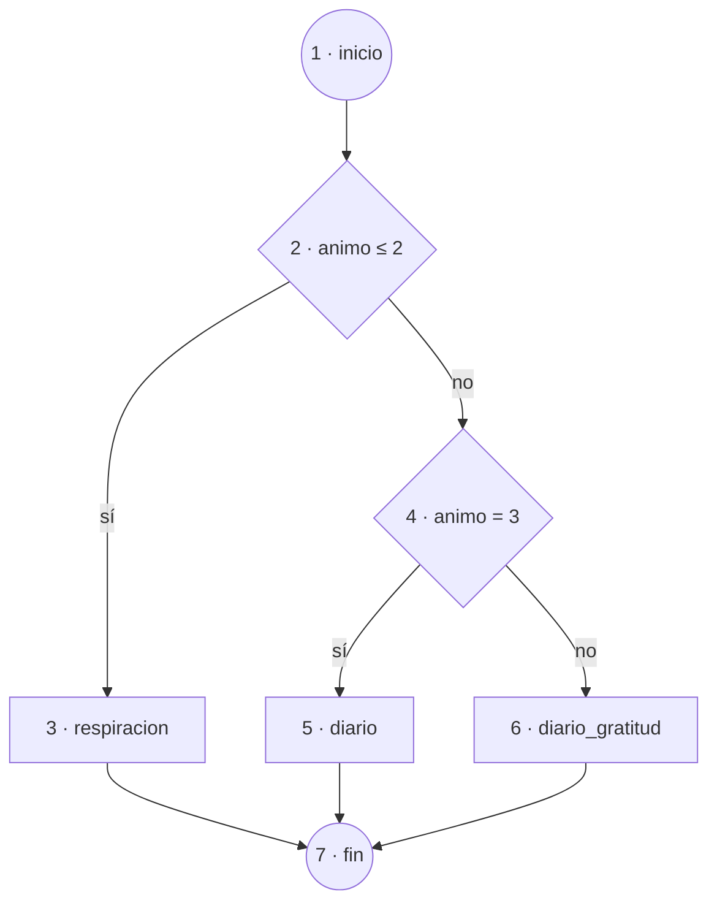

import BranchExplorer from '@site/src/components/BranchExplorer';

# Pruebas: análisis de caja blanca

Las pruebas de **caja blanca** se diseñan conociendo el código. Aplicamos el método del **camino básico** a la función `recomendar` (ver [implementación](../implementación/estructura_proyecto.md)).

## 1. Código analizado

```ts
function recomendar(animo: number): Ejercicio {
  if (animo <= 2) {            // decisión 1
    return 'respiracion';
  }
  if (animo === 3) {           // decisión 2
    return 'diario';
  }
  return 'diario_gratitud';
}
```

## 2. Grafo de flujo




## 3. Complejidad ciclomática

Con N = 7 nodos, A = 8 aristas y P = 1 componente conexa:

```text
V(G) = A - N + 2P = 8 - 7 + 2 = 3
```

También: nº de decisiones + 1 = 2 + 1 = **3**. Hacen falta **3 caminos independientes**.

## 4. Caminos y casos de prueba

| Camino | Nodos recorridos | Entrada | Salida esperada |
| --- | --- | --- | --- |
| C1 | 1-2-3-7 | `animo = 1` | `'respiracion'` |
| C2 | 1-2-4-5-7 | `animo = 3` | `'diario'` |
| C3 | 1-2-4-6-7 | `animo = 5` | `'diario_gratitud'` |

Añadimos **valores límite** (`animo = 2`, `animo = 4`) para vigilar las fronteras de cada condición.

```ts title="__tests__/recomendador.test.ts"
import { recomendar } from '../src/domain/recomendador';

test.each([
  [1, 'respiracion'],
  [2, 'respiracion'],
  [3, 'diario'],
  [4, 'diario_gratitud'],
  [5, 'diario_gratitud'],
])('animo %i -> %s', (animo, esperado) => {
  expect(recomendar(animo)).toBe(esperado);
});
```

## 5. Pruébalo tú

Mueve el deslizador y comprueba cómo cambia el camino ejecutado. Cubre los tres caminos para llegar al 100 %.

<BranchExplorer />

## 6. Resultado

| Métrica | Objetivo | Obtenido |
| --- | --- | --- |
| Cobertura de sentencias | 100 % | 100 % |
| Cobertura de ramas | 100 % | 100 % |
| Caminos independientes | 3 | 3 |
